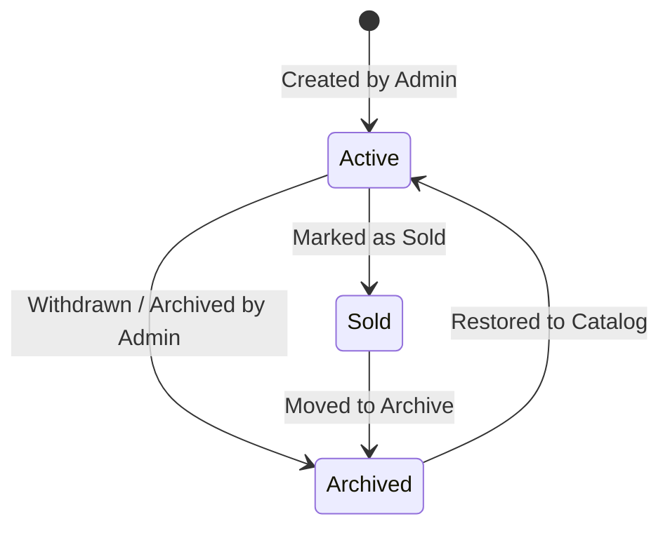
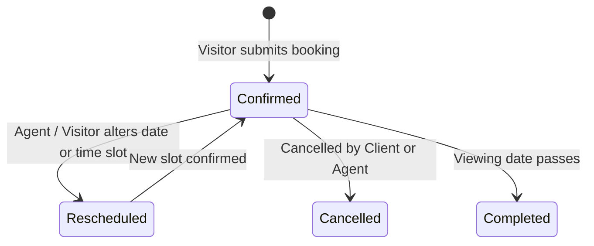

# Data Model: Real Estate Property Viewing & Booking System

**Feature**: `001-property-viewing-booking`  
**Date**: 2026-10-19  
**Status**: Ready  

---

## 1. Entity Definitions

### Property
Represents an individual real estate listing available for sale or rent.

| Field | Type | Required | Description |
| :--- | :--- | :---: | :--- |
| `id` | string (UUID) | Yes | Unique property identifier |
| `title` | string | Yes | Headline title (e.g., "The Bel-Air Skyline Villa") |
| `slug` | string | Yes | URL-friendly slug |
| `description` | string | Yes | Rich overview and marketing description |
| `price` | number | Yes | Listing price in USD |
| `propertyType` | string (enum) | Yes | `'house'`, `'apartment'`, `'villa'`, `'penthouse'`, `'townhouse'` |
| `listingType` | string (enum) | Yes | `'for_sale'`, `'for_rent'` |
| `status` | string (enum) | Yes | `'active'`, `'archived'`, `'sold'` |
| `location` | object | Yes | Address and geographical context |
| `location.address` | string | Yes | Street address |
| `location.city` | string | Yes | City/Neighborhood (e.g., "Beverly Hills", "Downtown") |
| `location.state` | string | Yes | State/Region code |
| `location.zipCode` | string | Yes | Postal/Zip code |
| `location.lat` | number | Yes | Latitude for map pin |
| `location.lng` | number | Yes | Longitude for map pin |
| `specs` | object | Yes | Key architectural specifications |
| `specs.bedrooms` | number | Yes | Bedroom count (e.g., 4) |
| `specs.bathrooms` | number | Yes | Bathroom count (e.g., 3.5) |
| `specs.areaSqFt` | number | Yes | Total interior area in square feet |
| `specs.yearBuilt` | number | No | Construction year |
| `specs.garageSpaces` | number | No | Parking/garage capacity |
| `amenities` | string[] | Yes | Feature tags (e.g., "Infinity Pool", "Wine Cellar", "Smart Home") |
| `featuredImage` | string (URL) | Yes | Main cover photo |
| `gallery` | string[] (URLs) | Yes | Array of 4-8 high-resolution photo URLs |
| `assignedAgentId` | string (FK) | Yes | Foreign key reference to Agent |
| `createdAt` | string (ISO-8601) | Yes | Listing creation timestamp |
| `updatedAt` | string (ISO-8601) | Yes | Last modification timestamp |

---

### Agent
Represents an agency staff member responsible for property viewings and client communication.

| Field | Type | Required | Description |
| :--- | :--- | :---: | :--- |
| `id` | string (UUID) | Yes | Unique agent identifier |
| `name` | string | Yes | Full name (e.g., "Alexandra Vance") |
| `email` | string | Yes | Contact email address |
| `phone` | string | Yes | Direct phone number |
| `role` | string | Yes | Job title (e.g., "Senior Luxury Specialist") |
| `avatar` | string (URL) | Yes | Agent profile portrait image |
| `bio` | string | Yes | Professional summary |

---

### AvailabilitySchedule & Blackout
Defines bookable viewing windows and excluded dates per property.

| Field | Type | Required | Description |
| :--- | :--- | :---: | :--- |
| `id` | string (UUID) | Yes | Unique schedule rule identifier |
| `propertyId` | string (FK) | Yes | Target property reference |
| `daysOfWeek` | number[] | Yes | Array of active days (0 = Sunday, 1 = Monday, ..., 6 = Saturday) |
| `startHour` | number | Yes | Operating start hour (24h format, e.g., 9) |
| `endHour` | number | Yes | Operating end hour (24h format, e.g., 18) |
| `slotDurationMinutes`| number | Yes | Duration of viewing slot (default: 45) |
| `bufferMinutes` | number | Yes | Buffer between viewings (default: 15) |
| `blackoutDates` | string[] | Yes | Array of blocked dates (`YYYY-MM-DD`) |

---

### BookingRequest
Represents an in-person viewing reservation made by a prospective client.

| Field | Type | Required | Description |
| :--- | :--- | :---: | :--- |
| `id` | string (UUID) | Yes | Unique booking identifier |
| `propertyId` | string (FK) | Yes | Target property reference |
| `propertyTitle` | string | Yes | Denormalized title for fast display |
| `date` | string (`YYYY-MM-DD`)| Yes | Booked viewing date |
| `timeSlot` | string | Yes | Selected time window (e.g., "14:00 - 14:45") |
| `clientName` | string | Yes | Prospective buyer's full name |
| `clientEmail` | string | Yes | Prospective buyer's email address |
| `clientPhone` | string | Yes | Prospective buyer's phone number |
| `notes` | string | No | Optional visitor comments or special requests |
| `status` | string (enum) | Yes | `'confirmed'`, `'pending'`, `'rescheduled'`, `'cancelled'` |
| `agentId` | string (FK) | Yes | Assigned agent reference |
| `createdAt` | string (ISO-8601) | Yes | Booking submission timestamp |
| `updatedAt` | string (ISO-8601) | Yes | Status change timestamp |

---

### NotificationRecord
Simulated transactional communication log for client and agent notifications.

| Field | Type | Required | Description |
| :--- | :--- | :---: | :--- |
| `id` | string (UUID) | Yes | Unique notification record identifier |
| `bookingId` | string (FK) | Yes | Associated booking reference |
| `recipientRole` | string (enum) | Yes | `'client'`, `'agent'` |
| `recipientEmail`| string | Yes | Target email address |
| `subject` | string | Yes | Email subject line |
| `type` | string (enum) | Yes | `'confirmation'`, `'reminder'`, `'agent_alert'`, `'status_change'` |
| `contentHtml` | string | Yes | Fully rendered HTML email message |
| `sentAt` | string (ISO-8601) | Yes | Timestamp of dispatch |
| `status` | string (enum) | Yes | `'delivered'`, `'opened'` |

---

## 2. Entity State Transitions

### Property Status Lifecycle

### Booking Request Lifecycle

---

## 3. Validation Rules

- **Property**:
  - `price` must be greater than zero.
  - `specs.bedrooms` and `specs.bathrooms` must be `>= 0`.
  - `specs.areaSqFt` must be `>= 100`.
  - `featuredImage` must be a valid URL string.
- **Booking Submission**:
  - `clientName` must contain at least 2 characters.
  - `clientEmail` must match standard email regex `^[^\s@]+@[^\s@]+\.[^\s@]+$`.
  - `clientPhone` must contain at least 8 digits with international support.
  - `date` cannot be in the past (`date >= today`).
  - `timeSlot` cannot be already taken for the given `propertyId` and `date` with status not equal to `'cancelled'`.
